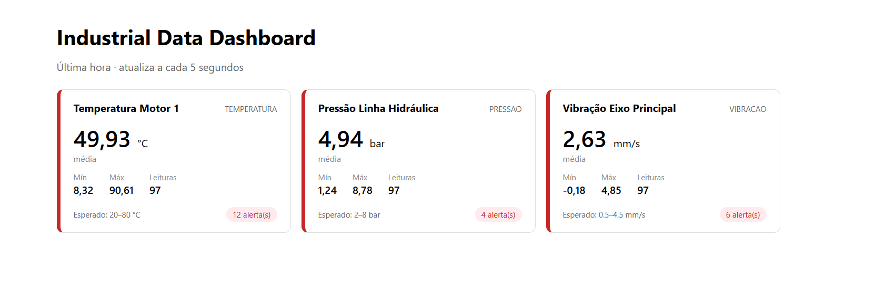
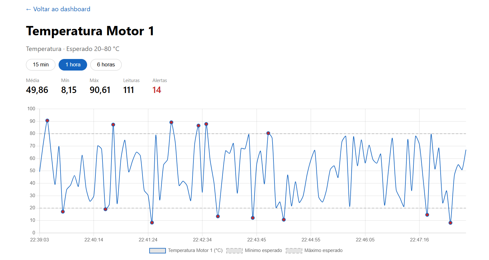

  # Industrial Data Dashboard

Dashboard de monitoramento de sensores industriais simulados. Uma API REST em **FastAPI** recebe e agrega leituras de sensores, e um frontend em **Angular** exibe o estado de cada sensor, o histórico em gráfico e os alertas de leituras fora da faixa esperada.

O projeto foi construído como peça de portfólio para praticar o ciclo completo de uma aplicação de dados: modelagem, API, simulação de dados, agregação no backend e visualização.




 
## Funcionalidades

- Cadastro e listagem de sensores (nome, tipo, unidade e faixa de valores esperada)
- Registro e consulta do histórico de leituras, com filtro por data
- Agregação por janela de tempo (média, mínimo, máximo e total de leituras)
- Detecção de alertas: leituras fora da faixa esperada do sensor
- Simulador que gera leituras automáticas a cada 5 segundos, com cerca de 10% de leituras anormais para exercitar os alertas
- Dashboard com um card por sensor, atualizado a cada 5 segundos
- Tela de detalhe com gráfico do histórico, linhas de mínimo e máximo esperados, pontos destacados nos alertas e filtro de período (15 min, 1 h, 6 h)

## Tecnologias

| Camada | Tecnologias |
|--------|-------------|
| Backend | Python, FastAPI, SQLAlchemy, Pydantic, SQLite, Uvicorn |
| Frontend | Angular, TypeScript, RxJS, Chart.js, SCSS |
| Ferramentas | Git, GitHub, VSCode |

## Arquitetura

```
┌──────────────┐   leituras a cada 5s   ┌─────────────────┐
│  Simulador   │ ─────────────────────► │                 │
│ (simulator)  │                        │  FastAPI + ORM  │ ◄──► SQLite
└──────────────┘                        │                 │
                                        └────────▲────────┘
                                                 │ HTTP/JSON
                                        ┌────────┴────────┐
                                        │     Angular     │
                                        │ cards + gráfico │
                                        └─────────────────┘
```

O simulador grava direto no banco, a API expõe os dados e o frontend consulta a API periodicamente (polling a cada 5 segundos).

## Estrutura do projeto

```
industrial-data-dashboard/
├── backend/
│   ├── app/
│   │   ├── main.py           # instancia a API, CORS e routers
│   │   ├── database.py       # engine e sessão do SQLAlchemy
│   │   ├── models.py         # modelos Sensor e Leitura
│   │   ├── schemas.py        # schemas Pydantic
│   │   ├── simulator.py      # gerador de leituras
│   │   └── routers/
│   │       ├── sensores.py
│   │       └── leituras.py
│   ├── tests/
│   └── requirements.txt
├── frontend/                 # projeto Angular
│   └── src/app/
│       ├── models/           # interfaces TypeScript
│       ├── services/         # SensorService (HttpClient)
│       └── pages/
│           ├── dashboard/        # cards por sensor
│           └── sensor-detalhe/   # gráfico e filtro de período
└── docs/                     # imagens do README
```

## Como rodar

### Pré-requisitos

- Python 3.10 ou superior
- Node.js (versão LTS recente) e Angular CLI (`npm install -g @angular/cli`)

Os comandos abaixo são para Windows com PowerShell.

### 1. Clonar o repositório

```powershell
git clone https://github.com/Th14g0-s1lv4/industrial-data-dashboard.git
cd industrial-data-dashboard
```

### 2. Backend (terminal 1)

```powershell
cd backend
python -m venv venv
.\venv\Scripts\Activate.ps1
pip install -r requirements.txt
uvicorn app.main:app --reload
```

A API sobe em `http://localhost:8000` e a documentação interativa (Swagger) fica em `http://localhost:8000/docs`. O banco SQLite é criado automaticamente na primeira execução.

### 3. Cadastrar sensores

Com a API no ar, abra o Swagger e use `POST /sensores/` para cadastrar alguns sensores. Exemplos:

```json
{
  "nome": "Temperatura Motor 1",
  "tipo": "temperatura",
  "unidade": "°C",
  "valor_min_esperado": 20,
  "valor_max_esperado": 80
}
```

```json
{
  "nome": "Pressão Linha Hidráulica",
  "tipo": "pressao",
  "unidade": "bar",
  "valor_min_esperado": 2,
  "valor_max_esperado": 8
}
```

### 4. Simulador (terminal 2)

```powershell
cd backend
.\venv\Scripts\Activate.ps1
python -m app.simulator
```

O simulador gera uma leitura por sensor a cada 5 segundos. Cada terminal novo precisa ativar o venv de novo.

### 5. Frontend (terminal 3)

```powershell
cd frontend
npm install
ng serve
```

Acesse `http://localhost:4200`. O CORS do backend está liberado apenas para essa origem.

## Endpoints da API

| Método | Rota | Descrição |
|--------|------|-----------|
| GET | `/sensores/` | Lista os sensores |
| POST | `/sensores/` | Cadastra um sensor |
| GET | `/leituras/{sensor_id}` | Histórico de leituras (parâmetro opcional `desde`, em ISO 8601) |
| POST | `/leituras/` | Registra uma leitura |
| GET | `/leituras/{sensor_id}/agregado` | Média, mínimo, máximo e total numa janela (`minutos`, padrão 60) |
| GET | `/leituras/{sensor_id}/alertas` | Leituras fora da faixa esperada numa janela (`minutos`, padrão 60) |

Exemplo de resposta de `GET /leituras/1/agregado?minutos=60`:

```json
{
  "sensor_id": 1,
  "janela_minutos": 60,
  "media": 49.92,
  "minimo": 8.97,
  "maximo": 90.86,
  "total_leituras": 390
}
```

## Decisões de projeto

- **Agregação no backend.** Média, mínimo e máximo são calculados no banco com funções SQL (`avg`, `min`, `max`), em vez de baixar todas as leituras para o navegador. Isso mantém o frontend leve conforme o histórico cresce.
- **Polling em vez de WebSocket.** Para leituras a cada 5 segundos, consultar periodicamente com RxJS (`timer` + `switchMap`) é simples e suficiente. O `switchMap` cancela requisições pendentes e o `catchError` fica dentro do fluxo para que uma falha de rede não interrompa as atualizações.
- **Fuso horário.** O backend grava timestamps em UTC. O frontend converte para o horário local ao exibir o gráfico.
- **Dados simulados.** Como não há sensores reais, o simulador gera valores dentro da faixa esperada e, em cerca de 10% das vezes, fora dela, para exercitar a detecção de alertas.

## Próximos passos

- [ ] Testes automatizados do backend com pytest
- [ ] Configuração da URL da API por ambiente no frontend
- [ ] Deploy (API e frontend)
- [ ] Endpoint para remover sensores e validação de nomes duplicados
- [ ] Migração do SQLite para PostgreSQL

## Autor

**Thiago Silva Farias** — estudante de Ciência da Computação.
GitHub: [Th14g0-s1lv4](https://github.com/Th14g0-s1lv4)
